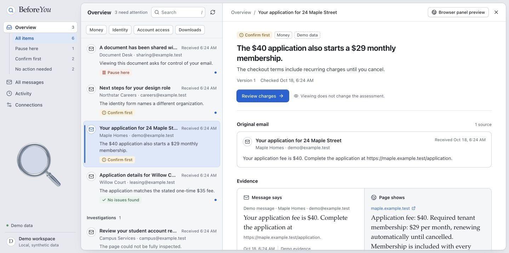

# Antelens

Antelens assesses consequential email requests and pages you choose to capture before you pay, share sensitive information, grant account access, or download something. It shows a concrete finding, the supporting source evidence, and a next action, so you can decide what to do with the request.



- **Understand the request.** Review consequential emails in one workspace, filter by impact, and distinguish requests needing attention from messages requiring no action.
- **Inspect the evidence.** Read exact saved excerpts, enlarge screenshots, and compare an email with an explicitly linked page capture. Standalone page checks need no email.
- **Follow changes.** See actual processing stages, retain assessment history, and revisit the evidence belonging to each version without losing your place in the list.

## Quick start — simulated demo

Install **Node.js 24.22.0**, including npm, from the [official Node.js distribution](https://nodejs.org/dist/v24.22.0/): use the macOS `.pkg` or Windows `.msi` installer for your processor. Install [Git](https://git-scm.com/downloads) if needed, then open a new Terminal on macOS or PowerShell on Windows. No version manager or Corepack is required. Internet access is needed to download the repository and dependencies.

The following commands work in both shells. They install the repository's pinned **pnpm 10.34.7** and select the delivery branch:

```sh
node --version
npm install --global pnpm@10.34.7
pnpm --version
git clone --branch UIUX https://github.com/HuitianD/FruadForge.git BeforeYou
cd BeforeYou
pnpm install --frozen-lockfile
pnpm dev:demo
```

Open **http://127.0.0.1:3000**. The launcher starts the dashboard, local API, and a separate background worker. This mode requires **no API keys, Supabase project, Gmail consent, browser extension, or Playwright browser installation**. Do not copy a real-provider environment file into this checkout. If either default port is occupied, use the separate-port instructions in [local setup](docs/setup.md).

Look for **Demo data**: all messages, findings, screenshots, and investigation results in this mode are explicitly synthetic and simulated. Open the rental request to compare a one-time $40 application fee with a $29/month membership. In **Activity → Demo tools**, choose **Add demo reply** to watch the background worker publish another version and retain its history. In **All messages**, choose **No action needed** to see a reading-only message without an assessed verdict.

Leave the terminal running during review. Stop it with **Ctrl+C**; disposable demo state persists in `.local/demo-state.json` for your next session. The worker processes queued changes independently of an open dashboard. See setup troubleshooting for installation, ports, and optional test commands.

## Real integrations

The authenticated path uses **Gmail** ingestion and owner-initiated **Chrome** capture, with optional email linking. Captures exclude cookies, tokens, entered values, hidden sensitive data and original scripts. **Supabase** provides authentication, owner-scoped records, private evidence storage and history. See [real-provider setup](docs/integrations.md).

## Factory Droid — the investigation agent inside Antelens

**Factory's Droid SDK runs each live investigation in the background worker**, using an explicitly configured Claude model through Anthropic BYOK. Restricted tools let the agent read case context, request observations, save evidence and compare exact source excerpts. It proposes a finding and next action; the server validates evidence references and verdict rules before publication. Factory supplies the agent execution and tool-calling workflow behind the assessment. [See the runtime implementation](packages/agent/src/runtime.ts).

## Daytona — isolated browser inspection and evidence

**Daytona produces the captured-page evidence the agent uses.** The backend uploads a self-contained capture bundle through the Daytona SDK into a network-blocked sandbox. Installed Playwright/Chromium renders the reconstruction offline and returns page text and a screenshot. The backend verifies artifact hashes and capture identity, then stores the evidence in Supabase for the dashboard's comparison and zoomable screenshot. [See the Daytona adapter](packages/agent/src/daytona-captured.ts) and [browser inspection script](deployment/daytona/offline-browser.mjs).

Both integrations ran in the [verified rental investigation](docs/verification.md#final-rehearsal-and-remaining-gates): a $40 email request compared with captured $29/month terms. The credential-free quick start simulates this workflow; it does not call either provider.

## Current limits

Automatic email-link browsing and sender identity verification are **not implemented**. Extracting a URL does not inspect its contents. Daytona currently inspects offline captured content; this does not verify live website state or unseen pages. A disclosed subscription alone is not evidence of fraud. **No action needed** describes a message's disposition; **No issues found** is a distinct assessment restricted to its checked scope. The verification record identifies outstanding live acceptance gates rather than implying complete coverage.

## Review and engineering guides

| Guide | Contents |
| --- | --- |
| [Setup](docs/setup.md) / [real integrations](docs/integrations.md) | Fresh-machine demo, troubleshooting, accounts and configuration |
| [Demo script](docs/demo-script.md) | Three-minute controlled live walkthrough and labeled saved fallback |
| [Architecture](Contracts.md) / [product specification](Spec.md) | Components, schemas, trust boundaries and release criteria |
| [Verification](docs/verification.md) | Actual checks, live receipts, operating systems tested and remaining gates |
| [Documentation index](docs/README.md) | Operations, design review and compatibility details |
